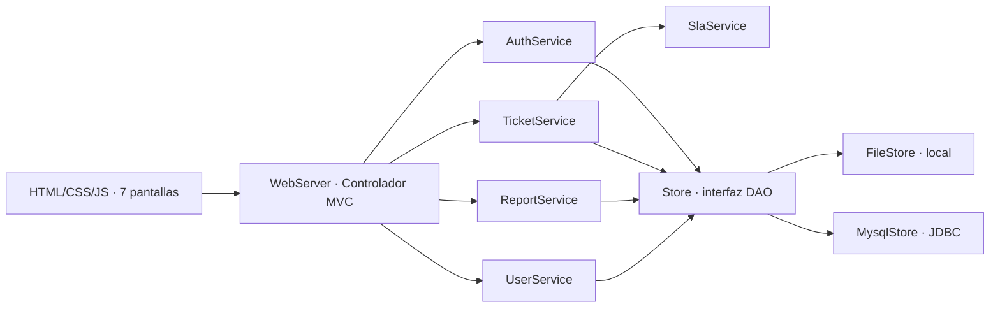
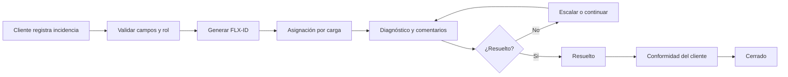

# Arquitectura, trazabilidad y cobertura de los requisitos

## Matriz funcional

| ID | Requisito | Módulo | API Java | Estado |
|---|---|---|---|---|
| RF01 | Registro de incidencia (categoría, título, prioridad, descripción) | Nuevo Ticket | POST /api/tickets | Implementado |
| RF02 | Código único por incidencia | Nuevo Ticket | TicketService.create | Implementado |
| RF03 | Evidencias adjuntas | Nuevo Ticket / Detalle | POST /api/tickets/{id}/adjuntos | Implementado |
| RF04 | Asignación por disponibilidad y carga; reasignación manual | Nuevo Ticket / Detalle | TicketService.selectTechnician / POST .../asignar | Implementado |
| RF05 | Estados de incidencia | Detalle / Kanban | POST /api/tickets/{id}/estado | Implementado |
| RF06 | Comentarios y notas internas | Detalle | POST /api/tickets/{id}/comentarios | Implementado |
| RF07 | Seguimiento SLA | Dashboard / Detalle / Reportes | SlaService.status | Implementado |
| RF08 | Notificaciones de cambios de estado | Portal | Alertas visuales y auditoría; no hay correo SMTP | Parcial |
| RF09 | Escalamiento ante riesgo de vencimiento | Detalle | Estado ESCALADO manual; alerta calculada | Parcial |
| RF10 | Reportes PDF y Excel | Reportes | /api/reportes/exportar | Implementado |
| RF11 | Usuarios, roles y desactivación | Usuarios | /api/usuarios y PATCH /api/usuarios/{id} | Implementado |
| RF12 | Confirmación del cliente y cierre | Detalle | POST .../conformidad | Implementado |

## Requisitos no funcionales

| Código | Mecanismo aplicado | Comprobación |
|---|---|---|
| RNF01 | Formularios responsivos con validaciones | Revisar capturas y flujo de registro |
| RNF02 | Arranque local; sin dependencia externa para modo archivo | Verificación HTTP 200 / |
| RNF03 | Contraseñas hasheadas, RBAC y CSRF | Pruebas de acceso anónimo, cliente y administrador |
| RNF04 | Consultas filtradas y sincronización local | No se ejecutó prueba de estrés de 500 tickets |
| RNF05 | MVC / Service / DAO | Separación de paquetes, interfaz Store |
| RNF06 | HTML5, CSS3, JavaScript | Renderizado Chromium de prueba; compatibilidad Edge/Firefox no certificada |
| RNF07 | Auditoría de creación, cambios, comentarios, asignación | Tabla/colección auditoria |
| RNF08 | Mínima exposición de datos, contraseñas no serializadas | Protección técnica inicial; cumplimiento legal requiere revisión institucional |

## Matriz de roles

| Acción | Cliente | Técnico | Administrador |
|---|---:|---:|---:|
| Crear ticket | Sí, propio | No | Sí, cualquier cliente |
| Listar / ver ticket | Propio | Asignado o sin asignar | Todos |
| Publicar comentario | Propio | Asignado o sin asignar | Todos |
| Actualizar estado | No | Asignado | Todos |
| Reasignar técnico | No | No | Sí |
| Confirmar conformidad | Propio | No | Sí |
| Consultar reportes | No | Sí, propios | Sí, completos |
| Gestionar usuarios | No | No | Sí |

## Diagrama de arquitectura

## Flujo funcional del ticket

## Seguridad y responsabilidades

- El controlador valida sesión, origen y token CSRF; todos los cambios de dominio están en servicios.
- Los DTO públicos excluyen expresamente el hash de contraseña.
- El servicio de tickets exige propiedad por cliente o asignación al técnico.
- El DAO relacional usa `PreparedStatement`, transacciones e índices.
- Los archivos adjuntos se guardan con identificadores aleatorios y nunca se sirven por URL directa del sistema de archivos.
- La persistencia local transacciona con reemplazo atómico y bloqueos sincronizados.

## Fases para ampliación

1. SMTP/SMS de notificaciones reales y políticas de reintentos.
2. Escalamiento automático periódico bajo reglas de negocio aprobadas.
3. Prueba de estrés y métricas 99% de disponibilidad.
4. Despliegue HTTPS empresarial, base MySQL con pool JDBC y secretos administrados.
